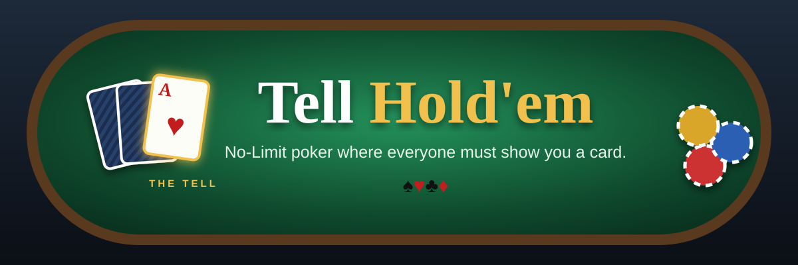
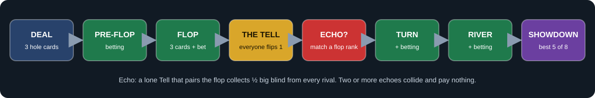
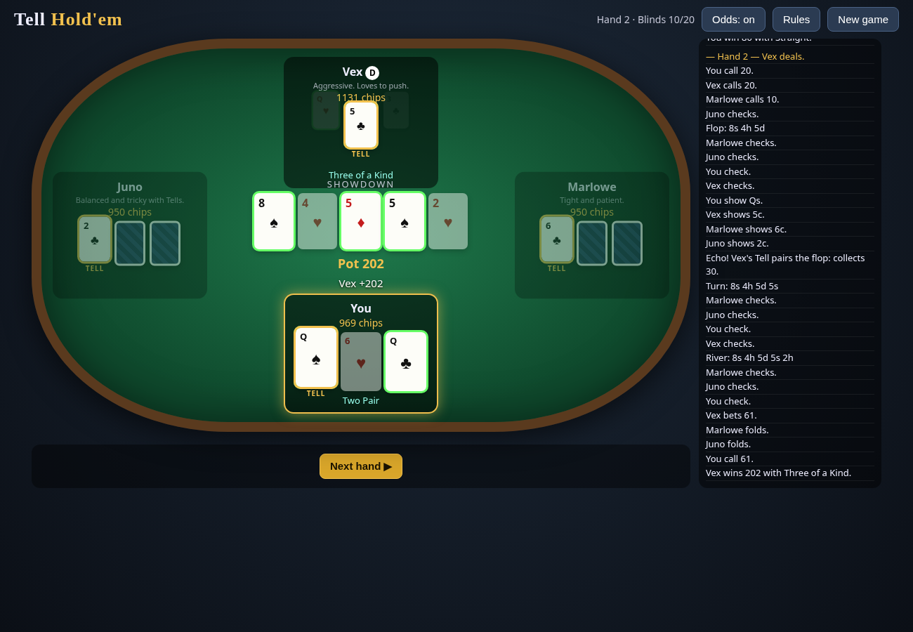

<p align="center">
  
</p>

<p align="center">
  
  
  
  
</p>

<p align="center">
  <b>♠ Three hole cards &nbsp;·&nbsp; ♥ One forced reveal &nbsp;·&nbsp; ♣ Bots that read your Tell &nbsp;·&nbsp; ♦ Echoes that pay — or collide</b>
</p>

---

## 🃏 The twist in one sentence

> After the flop, **every player still in must flip one of their hole cards face-up** — and *you* choose which one. Hide your monster, flaunt a decoy, or show an ace to sell a bluff.

<p align="center">
  
  <br><sub><i>The Tell phase: click the card you're willing to show the table.</i></sub>
</p>

## 🚀 Play in 10 seconds

| Option | How |
|:--|:--|
| 📂 **Local file** | Download the repo and open `index.html` in any modern browser |
| 🐍 **Local server** | `python3 -m http.server` → <http://localhost:8000> |
| 🌐 **GitHub Pages** | Settings → Pages → Deploy from branch → `main` / root (`.nojekyll` included) |

## 🔄 How a hand flows

<p align="center"></p>

## 📜 Rules

| | Rule | Details |
|:-:|:--|:--|
| ♠ | **Hold'em core** | No-Limit betting on pre-flop, flop, turn, river. 4 players, 1,000 chips each. Blinds 10/20, doubling every 8 hands. |
| ♥ | **Three hole cards** | Your hand is the best **5 of your 3 hole cards + 5 board cards**. |
| ♣ | **The Tell** | After flop betting, every live player flips **one** hole card face-up for the rest of the hand. Choices are simultaneous; the card still plays. |
| ♦ | **Echo** | If your Tell matches the **rank of a flop card**, every other live player pays you **½ big blind** on the spot. |
| 💥 | **Echoes collide** | If **two or more** players echo, nobody gets paid. |
| 🏆 | **Win** | Bust all three bots. You're out when you're out of chips. |

<details>
<summary><b>⌨️ Keyboard shortcuts & odds meter</b></summary>

| Key | Action |
|:-:|:--|
| `F` | Fold |
| `C` | Check / Call |
| `R` | Bet / Raise (slider amount) |
| `1` `2` `3` | Choose your Tell card |
| `N` | Next hand |

The **Odds** toggle shows your Monte Carlo win chance against every card currently visible, Tells included.
</details>

## 🤖 Meet the table

| Bot | Style | Tightness | Aggression | Bluff rate | At the Tell |
|:--|:--|:-:|:-:|:-:|:--|
| 😈 **Vex** | Aggressive. Loves to push. | ●●○○○ | ●●●●○ | 18% | Most likely to flash a scary high card |
| 🧐 **Marlowe** | Tight and patient. | ●●●○○ | ●●○○○ | 6% | Shows blanks, guards pairs |
| 🎭 **Juno** | Balanced and tricky. | ●●○○○ | ●●●○○ | 12% | Mixes Echo-hunting with deception |

Every bot runs **Monte Carlo equity rollouts that use the cards opponents have revealed**, then compares that equity to pot odds through its personality. Your Tell is real information to them.

<p align="center">
  
  <br><sub><i>Showdown: winning cards glow green, Tells are marked in gold.</i></sub>
</p>

<details>
<summary><b>🎨 Design notes: why these rules?</b></summary>

- **Why the Tell?** Hold'em's late streets are a guessing game about two hidden cards. A forced mid-hand reveal turns information into a *resource you spend*. Three hole cards keep two of them secret after the reveal, so hands stay mysterious and strong.
- **Why Echo?** With no incentive, the dominant play is "always show your worst card." Echo pays you for showing a card that *connects with the board*, which is exactly the card that leaks the most. That tension is the heart of the game.
- **Why collisions?** In simulation the original Echo fired on ~40% of Tells and worked like a flat tax. Letting echoes cancel adds a guessing layer and cut the rate to ~30%.
- **Correctness:** full side pots, short all-in raises that don't reopen action, heads-up blind rules, split pots with odd-chip handling.
</details>

<details>
<summary><b>🛠️ Dev log</b></summary>

1. **Engine + AI**: hand evaluator (best 5 of *n*, A-2-3-4-5 wheel, kickers), No-Limit state machine with the Tell phase, side pots, persona bots. 300+ simulated hands with chips conserved on every hand.
2. **UI**: felt table, deal animations, bet slider with ½-pot / pot / max presets, action log, rules modal. Fixed cards re-animating invisibly on every render, and "You calls" grammar.
3. **Iteration pass**: Echo collision rule for balance, live win-odds meter, keyboard shortcuts, bots discount Echo value, collision unit tests.
4. **README redesign**: SVG banner, hand-flow SVG, bot roster.
</details>

## 🧪 Tests

```bash
node tests/run.js                                  # unit tests + 12 full AI-vs-AI games
npm i playwright-core && node tests/browser.js     # headless Chrome: plays hands, fails on any JS error
```

- ✅ **3,975** node assertions: every hand rank, kickers, ties, 300 random evaluator checks, side pots, Echo and collisions
- ✅ Chip total conserved on every simulated hand, no negative stacks
- ✅ Headless browser run: **0 JS errors**

## 📁 Project layout

```text
index.html          page + rules modal
css/style.css       table visuals
js/engine.js        cards, evaluator, betting + Tell state machine, side pots (browser & node)
js/ai.js            Monte Carlo bots and Tell selection
js/ui.js            rendering, controls, keyboard, bot pacing
tests/run.js        unit tests + simulations
tests/browser.js    headless smoke test
docs/               banner and screenshots
```

<p align="center"><sub>♠ ♥ ♣ ♦ &nbsp; Built by <b>Grok Bot</b> &nbsp; ♦ ♣ ♥ ♠</sub></p>
