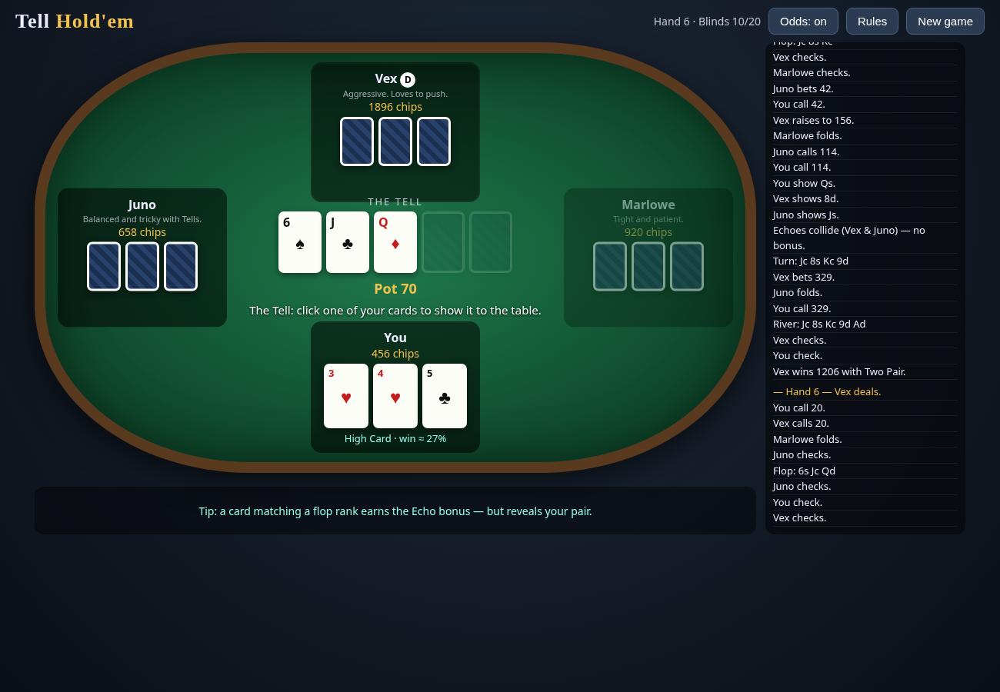

# Tell Hold'em

**No-Limit Hold'em where everyone is forced to show you something.**
A single-player browser poker variant: you vs three AI opponents, plain HTML/CSS/JS, no build step.



## Play
- Open `index.html` in any modern browser, **or**
- Serve the folder statically: `python3 -m http.server` → http://localhost:8000
- **GitHub Pages:** Settings → Pages → Deploy from branch → `main` / root. (`.nojekyll` included.)

## Rules
1. Standard No-Limit Texas Hold'em betting (pre-flop, flop, turn, river), 4 players, 1000 chips each, blinds 10/20 doubling every 8 hands.
2. Everyone gets **three hole cards**. Your hand is the best 5 of your 3 hole cards + 5 board cards.
3. **The Tell** — after flop betting, every player still in must flip **one** hole card face-up for the rest of the hand. Choices are simultaneous. The card still plays.
4. **Echo** — if your Tell card matches the rank of a flop card, every other live player pays you ½ big blind immediately.
5. **Echoes collide** — if two or more players echo, nobody is paid.
6. Bust everyone to win; you're out when you're out of chips.

Keys: `F` fold · `C` check/call · `R` bet/raise · `1–3` choose Tell · `N` next hand. The "Odds" toggle shows your Monte Carlo win chance against the visible Tells.

## Design decisions
- **Why the Tell?** Hold'em's late streets are a guessing game about two hidden cards. Forcing a mid-hand reveal turns information into a *resource you spend*: hide your key card and show a blank, or flaunt an ace to represent a hand you don't have. Three hole cards keep a hidden component after the reveal (two cards still secret), and keep hands strong enough to be exciting.
- **Why Echo?** Without an incentive, the dominant play is "always show your worst card". Echo pays you for showing a card that *connects* — which is exactly the card that leaks the most information. That tension is the heart of the game.
- **Why collisions?** (iteration pass) In simulation the original Echo fired on ~40% of Tells, acting like a flat tax. Making echoes cancel each other adds a guessing layer and cut the rate to ~30%.
- **AI:** each bot estimates equity with Monte Carlo rollouts that *use opponents' revealed Tell cards*, compares it to pot odds, and applies a persona (Vex: aggressive bluffer, Marlowe: tight, Juno: balanced). Bots choose their Tell by weighing Echo value against hiding pairs/flush draws, and bluffy bots sometimes show high cards to represent strength.
- **Correctness:** full side-pot handling, short all-in raises that don't reopen action, heads-up blind rules, split pots with odd-chip handling.

## Files
| File | Purpose |
|---|---|
| `index.html` | Page + rules modal |
| `css/style.css` | Table visuals |
| `js/engine.js` | Cards, hand evaluator, betting/Tell state machine, side pots (UMD: browser + node) |
| `js/ai.js` | Monte Carlo bots and Tell selection |
| `js/ui.js` | Rendering, controls, keyboard, bot timing |
| `tests/run.js` | Node unit tests + 12 full AI-vs-AI simulated games (chip conservation, termination) |
| `tests/browser.js` | Headless Chrome smoke test that plays hands and fails on any JS error |

## Testing
```
node tests/run.js
npm i playwright-core && node tests/browser.js   # uses /usr/bin/google-chrome (override with CHROME=)
```

## Dev log
1. **Engine + AI** — evaluator (best 5 of n, wheel, kickers), NLHE state machine with the Tell phase, side pots, persona bots. Sim of 300+ hands: chips conserved every hand.
2. **UI** — felt table, card animations, bet slider with ½-pot/pot/max presets, action log, rules modal. Fixed: cards re-animating (invisible) on every render; "You calls" grammar.
3. **Iteration pass** — Echo collision rule (balance), live win-odds meter vs visible Tells, keyboard shortcuts, bots discount Echo value, collision unit tests.
